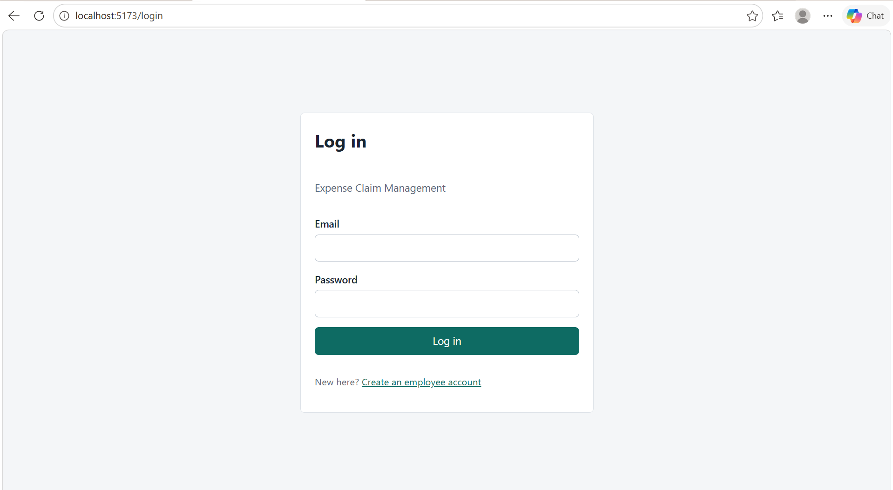
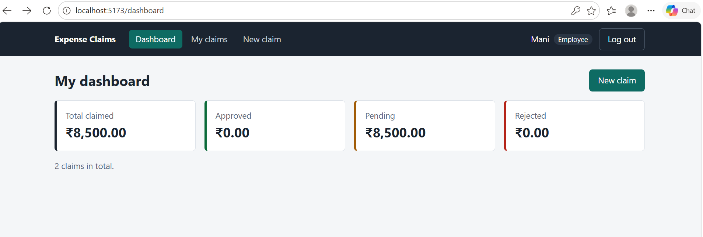
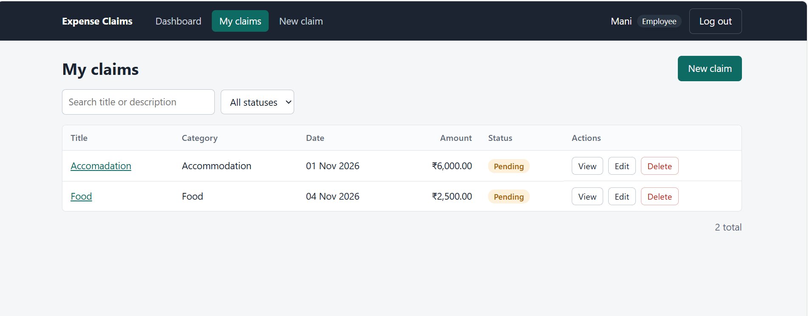
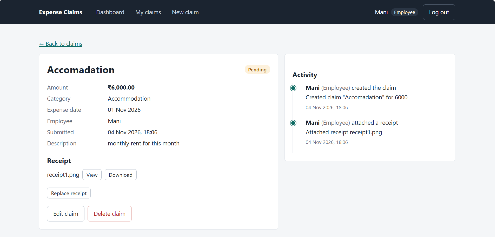
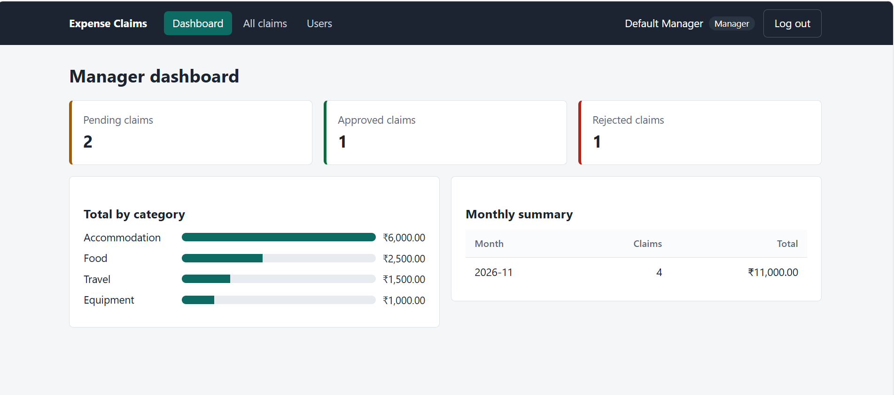
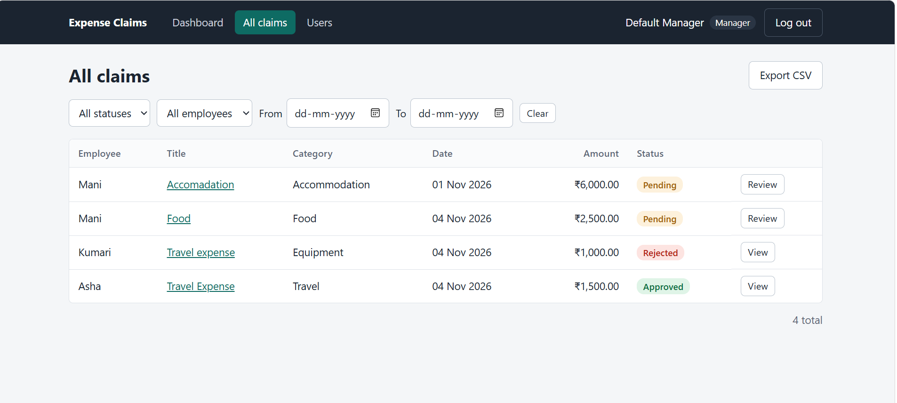
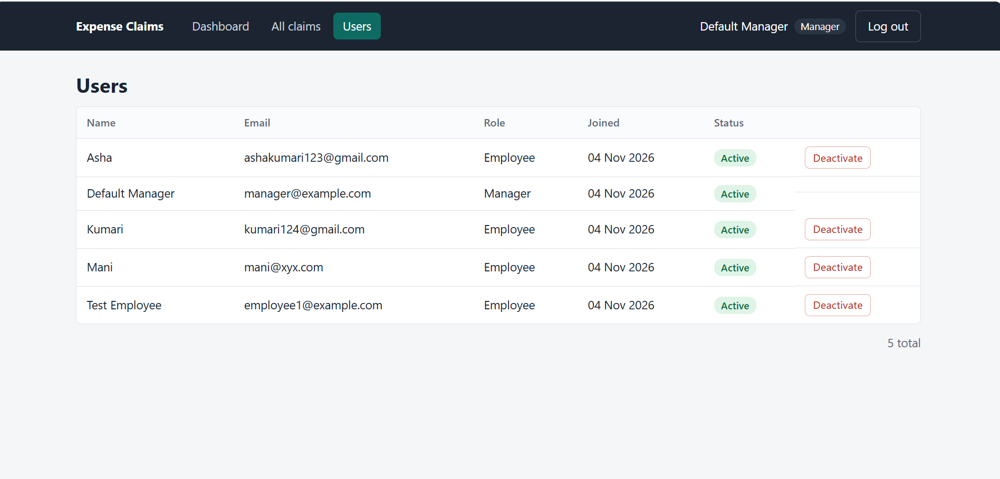
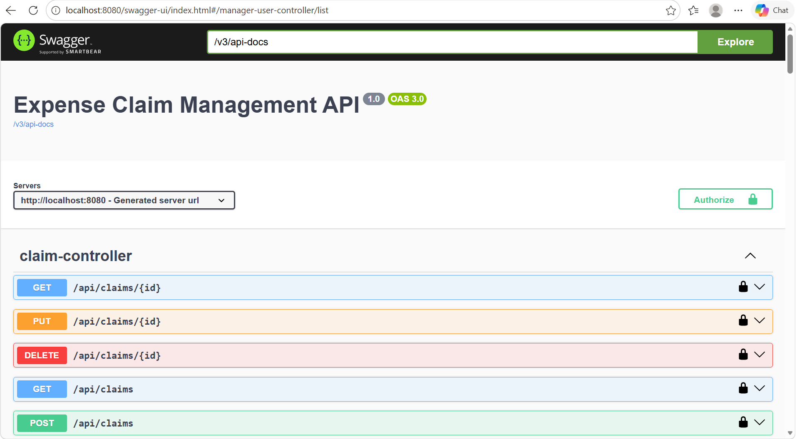

# Expense Claim Management System

A full-stack, role-based expense claim application. Employees submit expense claims with receipts; managers review them and approve or reject with a comment. Every action is recorded in an audit log.

- **Backend:** Java 17, Spring Boot 3.3, Spring Security + JWT, Spring Data JPA (Hibernate), MySQL 8
- **Frontend:** Angular 18 (standalone components, signals, Reactive Forms, HTTP interceptor, route guards)
- **Extras:** Swagger UI, Docker Compose, CSV export, 16 unit tests

```
Angular --HttpClient + JWT--> Spring Boot REST API --JPA--> MySQL
 route guards, role-based UI    JwtAuthFilter -> Controller -> Service -> Repository
 (usability only)               DTOs, @Valid, GlobalExceptionHandler, receipts on disk
```

## Features

**Employee**
- Register (always created as an Employee) and log in
- Create, edit and delete own claims (title, amount, category, expense date, description), only while the claim is **Pending**
- Search, filter by status and paginate the claim list
- Attach a receipt (JPEG, PNG or PDF, max 5 MB)
- Dashboard with claimed, approved, rejected and pending totals
- Claim details page with an activity timeline (audit log)

**Manager**
- View all claims, filtered by status, employee and date range
- Approve or reject (a comment is mandatory when rejecting; reviewed claims are final)
- View or download receipts, export claims to CSV
- Dashboard with counts by status, totals by category and a monthly summary
- View users and activate or deactivate them (deactivated users cannot log in)

## Quick start (local)

Requirements: Java 17+, Maven 3.9+, Node 18.19+ (or 20+), MySQL 8 running on `localhost:3306`.

```bash
# 1. Backend (creates the expense_db database automatically)
cd backend
# If your MySQL password is not "root", set it for this terminal:
#   PowerShell: $env:SPRING_DATASOURCE_PASSWORD="your-password"
mvn spring-boot:run          # http://localhost:8080

# 2. Frontend (new terminal)
cd frontend
npm install
npm start                    # http://localhost:4200
```

Run the unit tests: `cd backend && mvn test`

## Quick start (Docker Compose)

```bash
docker compose up --build
```

- App: http://localhost:3000
- API: http://localhost:8080
- Swagger UI: http://localhost:8080/swagger-ui.html

## Sample logins

| Role     | Email                | Password     |
|----------|----------------------|--------------|
| Manager  | manager@example.com  | Manager@123  |
| Employee | Register any account on the `/register` page (always created as an Employee) |

The manager account is seeded at startup (values come from `app.seed.*` in `application.properties`).

## Technologies used

| Area | Technology | Purpose |
|------|------------|---------|
| Backend | Java 17, Spring Boot 3.3 | REST API |
| Security | Spring Security, JWT (jjwt), BCrypt | Authentication, authorization, password hashing |
| Data | Spring Data JPA, Hibernate, MySQL 8 | Persistence |
| Validation | Jakarta Validation (`@Valid`) | Request validation |
| API docs | springdoc-openapi (Swagger UI) | Interactive API documentation |
| Testing | JUnit 5, Mockito | Unit tests |
| Build | Maven | Dependencies, build, tests |
| Frontend | Angular 18, TypeScript, RxJS | Single-page application |
| Frontend security | `CanActivate` guards, `HttpInterceptor` | Route protection, token handling |
| DevOps | Docker, Docker Compose, Nginx | One-command startup |
| Tooling | Git, GitHub, Node.js, npm, Angular CLI | Version control and build |

## Architecture

| Layer | Responsibility |
|-------|----------------|
| `JwtAuthFilter` | Reads the token on every request and authenticates the user (reloaded from the database each time) |
| Controller | Receives the request, validates it with `@Valid`, calls a service |
| Service | Business rules (ownership, pending-only, reject-needs-comment) and audit logging |
| Repository | Database access (Spring Data JPA, `Specification`s for dynamic filters) |
| DTO | Java records for request and response bodies, so entities are never exposed |
| `GlobalExceptionHandler` | Converts exceptions into JSON errors with the right HTTP status |

## Requirement checklist

| # | Requirement | Where |
|---|-------------|-------|
| 2 | Roles enforced on frontend and backend | `SecurityConfig`, `@PreAuthorize`, `core/guards.ts` |
| 3 | JWT access (15 min) + refresh (7 days, stored in DB, rotated, revocable), BCrypt | `AuthService`, `JwtService`, `RefreshToken` |
| 4 | Register = Employee, Manager seeded | `AuthService.register`, `DataSeeder` |
| 5 | Employee sees only own claims (404 for others) | `ClaimService.getOwnedClaim` (`findByIdAndEmployeeId`) |
| 6 | Edit/delete only while Pending | `ClaimService.requirePending` (409) |
| 7 | Pagination, search, status filter | `ClaimSpecifications`, `ClaimController.list` |
| 8 | Manager filters: status, employee, date range | `ManagerClaimController.list` |
| 9 | Approve/reject, comment required on reject, final | `ManagerClaimService.review` |
| 10 | Receipt upload (JPEG/PNG/PDF, 5 MB), view/download | `FileStorageService` |
| 11 | Audit log + timeline | `AuditService`, `shared/timeline.component.ts` |
| 12 | Dashboards | `DashboardService` |
| 13 | Activate/deactivate users | `UserService`, `UserDetailsImpl.isEnabled` |
| 14 | Route guards, Access Denied, role-based menus | `core/guards.ts`, `pages/layout.component.ts`, `pages/access-denied.component.ts` |
| 15 | Interceptor: attach token, refresh once, logout on failure | `core/auth.interceptor.ts` (Angular `HttpInterceptor`, the Angular equivalent of an Axios interceptor) |
| 16 | Form validation, loading and error states | Reactive Forms and all pages |
| 17-18 | Layered architecture, DTOs, `@Valid`, global handler | `controller / service / repository / dto / exception` |
| 19 | Unit tests (16) | `backend/src/test/...` |
| 20 | Swagger, Docker Compose, CSV export | `/swagger-ui.html`, `docker-compose.yml`, `GET /api/manager/claims/export` |

## API list

Auth (public)
```
POST   /api/auth/register        { name, email, password }
POST   /api/auth/login           { email, password }
POST   /api/auth/refresh         { refreshToken }
POST   /api/auth/logout          { refreshToken }
```

Employee (role EMPLOYEE, except where noted)
```
GET    /api/claims?page&size&search&status
POST   /api/claims
GET    /api/claims/{id}                 (employee: own only, manager: any)
PUT    /api/claims/{id}                 (pending only)
DELETE /api/claims/{id}                 (pending only, soft delete)
POST   /api/claims/{id}/receipt         (multipart field "file", pending only)
GET    /api/claims/{id}/receipt         (?download=true; owner or manager)
GET    /api/claims/{id}/audit-logs      (owner or manager)
GET    /api/dashboard/employee
```

Manager (role MANAGER)
```
GET    /api/manager/claims?status&employeeId&from&to&search&page&size
PATCH  /api/manager/claims/{id}/approve          { comment? }
PATCH  /api/manager/claims/{id}/reject           { comment }   (comment required)
GET    /api/manager/claims/export                 same filters, returns CSV
GET    /api/manager/users?page&size
PATCH  /api/manager/users/{id}/status            { active: true|false }
GET    /api/dashboard/manager
```

Status codes: `400` validation / missing reject comment / bad file, `401` missing or expired token / bad login,
`403` wrong role or deactivated account, `404` unknown claim or someone else's claim, `409` business rule
(not pending, already reviewed, duplicate email), `413` file too large.

## Design notes

- **404 instead of 403 for another user's claim** avoids revealing that the claim exists.
- **The backend is the real protection.** Frontend guards and hidden buttons are only for usability; every endpoint is protected by the Spring Security filter chain, `@PreAuthorize` and service-level ownership checks.
- **Deactivation takes effect immediately:** blocked at login and refresh, and `JwtAuthFilter` reloads the user on every request, so an already-issued access token stops working too.
- **Refresh tokens** are random UUIDs stored in the database, rotated on every refresh and revoked on logout.
- **Soft delete** keeps the audit trail. Audit logs are append-only and reference the claim by id only.
- **Money** is `BigDecimal` (`DECIMAL(12,2)`), never `double`.
- **Uploads:** content type, extension and file signature (magic bytes) are checked, and files are stored under a random UUID name, never the client's name.
- **CSV export** neutralises spreadsheet formula injection (cells starting with `= + - @`).
- Dynamic filters use JPA `Specification`s, which avoids null-parameter problems in JPQL.

## Screenshots

### Login


### Employee dashboard


### My claims (search, filter, pagination)


### Claim details with audit timeline


### Manager dashboard


### Manager claims list with filters


### Users management


### Swagger UI


## Project structure

```
backend/    Spring Boot API (config, controller, service, repository, entity, dto, security, exception)
frontend/   Angular app (core: services, interceptor, guards; shared components; pages)
docs/       Screenshots
docker-compose.yml
```

## Possible improvements

- Move secrets to environment variables or a secrets manager
- Store the refresh token in an HttpOnly cookie
- Use Flyway for database migrations instead of `ddl-auto=update`
- Add integration tests (Testcontainers) and frontend tests
- Store receipts in cloud storage (for example S3)
- Add rate limiting on login and optimistic locking on claim review